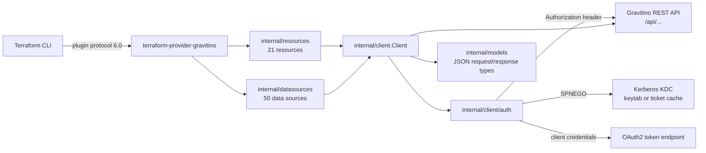

# Architecture

High-level design of the Terraform provider for Apache Gravitino. Repository conventions live in
[`AGENTS.md`](./AGENTS.md), the security argument in [`.github/SECURITY.md`](./.github/SECURITY.md)
and the direction of travel in [`ROADMAP.md`](./ROADMAP.md).

Numbers in this file are measured in this repository; the commands that produce them are next to
each figure.

## What the program is

A Terraform provider plugin implementing plugin protocol **6.0**
(`terraform-registry-manifest.json`), built on `terraform-plugin-framework` v1.19.0 and published
as `registry.terraform.io/caberdo/gravitino`. Terraform launches the compiled binary as a child
process and talks to it over the plugin protocol; the provider never runs inside the Terraform
process, and it holds no state of its own beyond the client it is configured with.



## Entry point and wiring

| Stage | Code | What happens |
|---|---|---|
| Process start | `main.go` | `providerserver.Serve` with `Address = registry.terraform.io/caberdo/gravitino`; `-debug` attaches a debugger. `version` is injected by GoReleaser (`-X main.version=…`) and is `dev` in a local build. |
| Provider identity | `internal/provider/provider.go` `Metadata` | `TypeName = "gravitino"`, version from the binary. |
| Schema | `internal/provider/provider.go` `Schema` | Thirteen optional attributes: `uri`, `auth`, `username`, `password`, `oauth_token`, `oauth_client_id`, `oauth_client_secret`, `oauth_server_uri`, `oauth_token_path`, `oauth_scope`, `kerberos_principal`, `kerberos_keytab`, `kerberos_use_ticket_cache`. `auth` is validated with `stringvalidator.OneOf("simple", "basic", "oauth", "kerberos", "none")`; four attributes are `Sensitive`. |
| Configure | `internal/provider/provider.go` `Configure` | Each attribute falls back to its `GRAVITINO_*` environment variable; an empty `uri` fails with an explicit diagnostic on `path.Root("uri")`; `buildAuthProvider` maps `auth` to an `auth.AuthProvider`; `client.New` builds the client; `DetectServerVersion` is called once, best effort; the same `*client.Client` is handed to `resp.ResourceData` and `resp.DataSourceData`. The URI is never logged. |
| Registration | `internal/provider/provider.go` `DataSources()` / `Resources()` | 50 and 21 constructors, one per line in those two lists (`ls docs/data-sources \| wc -l` = 50, `ls docs/resources \| wc -l` = 21). Each lives in its own package under `internal/`, so a resource's schema, state mapping and tests travel together. |

## The client (`internal/client`, 35 Go files)

`client.Client` is the only runtime state a resource or data source gets:

```go
type Client struct {
    baseURL      string
    httpClient   *http.Client
    authProvider auth.AuthProvider
    versionMu    sync.RWMutex
    version      string
}
```

* `New(uri, authProvider)` validates the URI (scheme must be `http` or `https`, host must not be
  empty) and builds one `http.Client` with a 30 s timeout. When the auth provider also implements
  `auth.TransportProvider` (Kerberos), `WrapTransport` is wrapped around `http.DefaultTransport`.
* `doRequest` is the single mediated path to the server: it prefixes `baseURL + "/api"`, sends
  `Accept: application/vnd.gravitino.v1+json`, marshals a JSON body with
  `Content-Type: application/json`, and asks the auth provider for the header pair to set.
  `Get`, `Post`, `Put`, `Patch` and `Delete` are thin wrappers over `do`.
* `do` maps every non-2xx response to `*HTTPError` and otherwise decodes the JSON envelope; an
  empty body (several `DELETE` endpoints) is not an error.
* `internal/client/paths.go` builds the URL paths and escapes every user-supplied segment with
  `url.PathEscape`, so callers pass raw names.
* One file per API area (`catalog.go`, `table.go`, `policy.go`, …) holds that area's REST methods;
  the wire types live in `internal/models` (39 files), written against the Gravitino
  **v1.3.0** OpenAPI specification and extended with the v1.3.1 additions.
* `FromProviderData` converts the framework's `any` provider data back into `*Client` and returns
  no diagnostics while the provider is not configured yet.

## Authentication (`internal/client/auth`, 12 files)

```go
type AuthProvider interface {
    Header(ctx context.Context) (string, string, error)
}

type TransportProvider interface {
    AuthProvider
    WrapTransport(base http.RoundTripper) http.RoundTripper
}
```

| `auth` value | Provider | Notes |
|---|---|---|
| `none` / empty | none | No `Authorization` header. |
| `simple` | `simple.go` | HTTP Basic carrying the resolved OS user (`GRAVITINO_USER`, else the current OS user, else `anonymous`) with an empty password. |
| `basic` | `basic.go` | HTTP Basic; `username` is required. |
| `oauth` with `oauth_token` | `oauth_static.go` | Static bearer token. |
| `oauth` with client credentials | `oauth_credentials.go` | `POST` to the token endpoint on its own 30 s client, token cached in memory with a margin before expiry, refreshes serialised so concurrent requests share one token. |
| `kerberos` | `kerberos.go` | SPNEGO through `WrapTransport`; reads a keytab or the OS ticket cache, and retries once on a `Negotiate` challenge (scheme compared case-insensitively). |

## Request flow

```
resource.tf ─► Terraform core ─► framework request (Config/Plan/State)
                                      │
                       req.Plan.Get(ctx, &model)      ← tfsdk-tagged model struct
                                      │
                       client.Client.Get/Post/…       →  /api/... on the Gravitino server
                                      │
                       resp.State.Set(ctx, &model)   → Terraform state
```

Conventions that make the CRUD paths uniform (counted in the working tree):

* Every API failure goes through `client.NewResourceError` (153 call sites) and every 404 through
  `client.IsNotFoundError` (69 call sites) followed by `resp.State.RemoveResource(ctx)`.
* `tflog.Debug` at every CRUD boundary (192 call sites).
* IDs are the dot-separated hierarchy (`metalake.catalog.schema`), parsed on import and rebuilt on
  rename.
* An attribute the API cannot update in place carries `RequiresReplace()` (71 uses); computed
  attributes either carry `UseStateForUnknown()` (41 uses) or are written on every code path.
* Enum attributes carry `stringvalidator.OneOf` with the values from the OpenAPI specification
  (30 uses); shared enums are constants in `internal/models/privilege_names.go`.
* Server-owned properties (`in-use`, `gravitino.identifier`, `gravitino.bypass.*`,
  `default-location-name`) are filtered out of state instead of becoming drift.

## Error model

* `client.HTTPError` carries the **real** HTTP status plus the decoded Gravitino envelope. The
  status is captured before decoding because the envelope's `code` field is an application code in
  the 1000–1100 range and can never be used to detect a 404 (`internal/client/errors.go`).
* `client.IsNotFoundError(err)` is the only sanctioned way to detect a 404; delete treats it as
  success, read removes the resource from state.
* `client.NewResourceError(operation, resource, err)` produces the diagnostics a user sees: a
  summary naming the operation and object, the server status and type, the server stack when
  present, and a hint for the common transport failures (connection refused, DNS, TLS, 401,
  timeout, non-API response body).
* Non-JSON error bodies are truncated to 2 KiB (`maxErrorBodyBytes`) before they reach the
  Terraform output.

## Server-version detection and the version gates

One provider build supports Gravitino **1.3.0 and 1.3.1** (`.github/gravitino-versions.txt`).
`provider.Configure` calls `client.DetectServerVersion` once (`GET /api/version`, best effort) and
keeps the result on the client. `client.ResolveServerVersion` returns that value and only probes
again when no version is known, so a gate normally costs no request of its own. Every comparison
goes through `models.ServerVersionAtLeast`, which treats an unparseable version as *too old*.

Four gate shapes are in use, and the difference between them is deliberate:

| Shape | Entry points | Unknown server version | Behaviour |
|---|---|---|---|
| Fail closed, short-circuiting | `CheckMetadataObjectTypeSupported`, `CheckPolicyObjectTypesSupported`, `CheckIndexesSupported` | rejected | Return without a version lookup unless the value itself is 1.3.1-only (`models.ObjectTypeRequiresGravitino131`, `models.IndexTypeRequiresGravitino131`), then reject when the version cannot be resolved. |
| Permissive | `AtLeast`, `SupportsExternalType` (used by `CheckExternalTypesSupported` / `CheckFunctionExternalTypesSupported`) | treated as current | An external data type is the only signal the provider has; a blocked version endpoint must not remove the ability to manage such a column. An explicit diagnostic is still produced when the detected version predates 1.3.1. |
| Fail open on the endpoint's own answer | `gravitino_iceberg_rest_service` | calls the 1.3.1-only endpoint, maps its 404 to the version diagnostic | Used only where the endpoint response is itself authoritative. |
| Resolve then fail closed | `gravitino_catalog_connection_test` | rejected for the existing-catalog variant only | The proposed-configuration variant works on 1.3.0. |

A restricted value always fails with a diagnostic naming the required version, never with the
server's opaque `400`, and the restriction is repeated in the schema description of every affected
attribute and data source.

## Repository layout

```
main.go, terraform-registry-manifest.json    entry point, protocol manifest
internal/
  acceptance/       live pre-check (real server), proto v6 factories, unique-name helper
  client/           HTTP client, per-area REST methods, path builders, version gates
    auth/           AuthProvider implementations (simple, basic, oauth ×2, kerberos)
  datasources/      one package per data source area (27 packages, 50 data sources)
  models/           JSON wire types, Terraform value conversion, shared enums
  provider/         provider schema, Configure, resource/data source registration
  resources/        one package per resource (23 packages: 21 resources plus
    resourceutil/   shared import-ID parsing
    resourcetest/   shared test harness for schema/metadata tests)
  tfutil/           pure framework-value ↔ Go-type conversions
docs/               generated by tfplugindocs — never hand-edit
templates/          the tfplugindocs templates the generated pages come from
examples/           documentation source: provider/, resources/, data-sources/, complete/
scripts/            validate-examples.{sh,py}, testacc-live.sh
.github/            workflows, golangci/goreleaser/dependabot configs, policies
```

`docs/` is generated: `main.go` carries
`//go:generate go run github.com/hashicorp/terraform-plugin-docs/cmd/tfplugindocs`, `make generate`
runs it, and the `Test` workflow fails when the regenerated tree differs from the committed one.
Change `templates/` or `examples/`, never `docs/` directly.

## Test layers

| Layer | Count | Location | Needs a server | What it proves |
|---|---|---|---|---|
| Unit | 615 `Test*` functions overall | `internal/**/*_test.go` | no — `httptest.NewServer` in 75 files | request shape, payload decoding, schema, plan modifiers, error mapping |
| Acceptance (`TestAcc*`) | 66 | `*_test.go` | no — an `httptest` server, driven by `TF_ACC=1` through Terraform Core (`providerserver.NewProtocol6WithError`) | that the provider produces consistent state end to end, which direct framework calls miss |
| Live acceptance (`TestLiveAcc*`) | 26 | `*_test.go` + `internal/acceptance` | yes — real Gravitino via podman | that real server behaviour matches the spec; `LivePreCheck` refuses to run against a mock (`contributing/live-acceptance-tests.md`) |
| Version matrix | 2 server versions | `.github/gravitino-versions.txt` | yes — Docker | the same suite passes on 1.3.0 and 1.3.1 (`make testacc-matrix`) |

Coverage, measured 2026-10-19 (55 of 56 packages under `./internal/...` have tests). `make coverage`
writes the unit profile, `make coverage-merge` merges it with the profile the acceptance container
writes (`-coverpkg=./internal/...`), and both print a per-package table that the `test`, `Coverage`
and `acceptance` jobs publish in their job summaries. `make coverage-gate` fails when a scope of the
merged profile is below a floor in `.github/coverage-baseline.txt`, the same file
`make coverage-readme` renders README.md's badge and block from.

| Command | Total |
|---|---|
| `make coverage` (unit only, per package) | 59.8% |
| `make coverage-merge` (unit + acceptance; the profile the gate enforces) | 79.2% |
| `make coverage-gate` floors | 78.5% total (`internal/client` 76.5, `internal/models` 84.0, `internal/provider` 69.5) |

The merged profile is the number to quote, and the gate is the number that blocks a pull request; a
bare `-coverprofile` measures each package against its own statements only. Statement counts depend
on the Go patch release that produced the profile (`go 1.27.1` sums `./internal/...` to 9766
statements, `go 1.27.2` to 7661) and a merged profile takes them from the profile
`merge-coverage.sh` reads last, so compare within one toolchain.

## Release pipeline

```
create-release-tag.yml (workflow_dispatch: patch|minor|major or X.Y.Z)
        ├─ import GPG key (secrets GPG_PRIVATE_KEY, PASSPHRASE)
        ├─ git tag -s vX.Y.Z + git tag -v, then push the signed tag
        └─► release.yml (workflow_call, same run; also runnable on a v* tag push
            or despatched manually with inputs.tag to republish an existing tag)
                  └─► goreleaser "~> v2", config .github/goreleaser.yml
                        ├─ CGO_ENABLED=0, -trimpath, -s -w, mod_timestamp = commit time
                        ├─ linux/darwin/windows × amd64/arm64, zip archives
                        ├─ <name>_<version>_SHA256SUMS (+ terraform-registry-manifest.json)
                        ├─ SHA256SUMS detach-signed with the release GPG key
                        ├─ actions/attest-build-provenance (OIDC) over the checksum file
                        │    └─ bundle attached as <name>_<version>_provenance.intoto.jsonl
                        ├─ SPDX-JSON SBOM (anchore/sbom-action)
                        └─ GitHub release with the registry install snippet (caberdo/gravitino)
```

The GPG private key and passphrase live in the repository's Actions secrets
(`GPG_PRIVATE_KEY`, `PASSPHRASE`) and are imported only by these workflows; the public half is
committed as `.github/release-signing-key.asc`, and `README.md#verifying-a-release` documents the
`gpg --verify` and `gh attestation verify` steps. Two details of the wiring are deliberate: tags
pushed with the default `GITHUB_TOKEN` do not trigger other workflows, so `create-release-tag.yml`
calls `release.yml` explicitly (with `id-token` and `attestations` write to mint the provenance
identity), and because GoReleaser runs with `release.mode: replace`, dispatching `release.yml` with
an existing tag republishes it idempotently instead of calculating a new version.
